<div align="center">


# AI모델 성능평가 자동화 플랫폼

**제출하는 순간 채점되고, 공정하게 검증됩니다**

수업용 폐쇄형 Kaggle — CSV 자동 채점 · 실시간 리더보드 · 관리자 2단계 검증 · 부정 제출 자동 탐지 · 격리 재실행

    

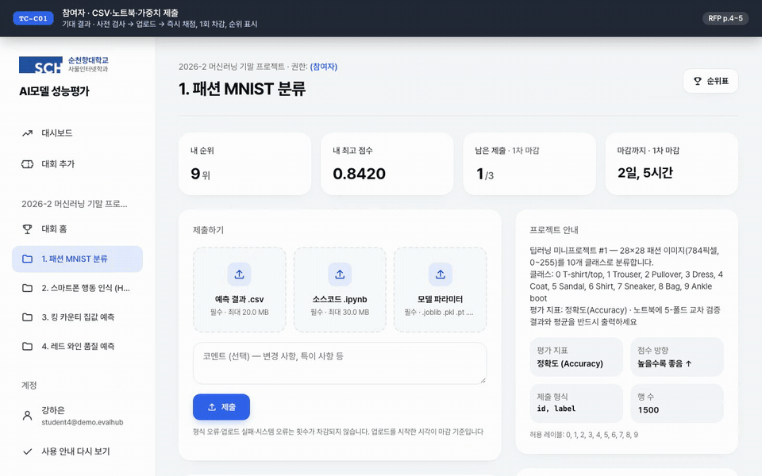

</div>

---

## 왜 만들었나

| 지금(수작업) | 이 플랫폼 |
|---|---|
| 조교가 CSV를 모아 손으로 채점·순위 정리 | 업로드 즉시 자동 채점, 리더보드 실시간 갱신 |
| 형식이 틀리면 메일로 재제출 요청 | 업로드 **전** 브라우저 사전 검사 + 행 단위 오류 안내, 횟수 미차감 |
| 노트북을 하나하나 열어 부정 여부 확인 | **무결성 리포트**가 의심 기록을 🔴🟡🟢로 1차 선별 |
| 성적 확정 근거가 남지 않음 | 관리자1 제안 → 관리자2 승인, 모든 판정이 **위변조 감지 감사 로그**에 기록 |

---

## 빠른 시작 (명령 1줄)

```bash
cp .env.example .env   # 필요하면 POSTGRES_PASSWORD, DJANGO_SECRET_KEY 수정
docker compose up --build
```

→ http://localhost:8000 접속. 첫 실행 시 **딥러닝 수업 미니프로젝트 1~4 를 그대로 옮긴 데모 대회**가 실제 모델 학습으로 자동 생성됩니다 (약 2분).
8000번 포트를 이미 쓰고 있다면 `WEB_PORT=8080 docker compose up --build` 처럼 바꿀 수 있습니다.

```bash
docker compose exec sandbox-worker python manage.py sandbox_selftest   # 샌드박스 공격 6종 자가 진단
docker compose exec web python manage.py integrity_experiment          # 부정 탐지 실험 (DB 변경 없이 롤백)
```

| 역할 | 이메일 | 비밀번호 | 둘러볼 곳 |
|---|---|---|---|
| 관리자2 (교수) | `prof@demo.evalhub` | `evalhub-demo-2026` | 대회 개설, 프로젝트 설정, 최종 승인, 감사 로그 위변조 검증 |
| 관리자1 (조교) | `ta@demo.evalhub` | `evalhub-demo-2026` | 검토 목록 → 부정 의심 점검 → 의견 제출, 회원 관리 |
| 참여자 (학생) | `student1@demo.evalhub` ~ `student14@demo.evalhub` | `evalhub-demo-2026` | 제출, 내 점수 추이, 익명 리더보드 |

**데모 대회 = 실제 수업 과제** — 순천향대 딥러닝 수업 미니프로젝트 1~4 를 같은 공개 데이터로 옮겼습니다 (출처·라이선스: [web/apps/core/demo_data/README.md](web/apps/core/demo_data/README.md))

| 프로젝트 | 데이터 | 지표 | 데모에서 볼 것 |
|---|---|---|---|
| 1. 패션 MNIST 분류 | 28×28 이미지 · 10클래스 | 정확도 | 학생 14명 경쟁 · 부정 제출 4종 적발 · 2단계 검토 |
| 2. 스마트폰 행동 인식 (HAR) | 센서 특성 561개 · 6가지 행동 | 정확도 | 교차 검증 출력을 빼먹은 제출 (I-8 🟡) |
| 3. 킹 카운티 집값 예측 | 주택 특성 18개 | RMSE | 훈련 데이터로 '검증'해 평균을 부풀린 제출 (I-8 🟡) |
| 4. 레드 와인 품질 예측 | 화학 특성 11개 | RMSE | 정상 제출 5건 |

모든 데모 노트북에는 **실제로 계산한 5-폴드 교차 검증 결과와 평균**이 출력돼 있고 (수업 규칙), 공식 점수는 학생이 볼 수 없는 평가용 정답으로 매깁니다.

> 데모 비밀번호는 시연 전용으로 공개된 값입니다. 운영 시 `.env`에서 `DEMO_MODE=false`로 바꾸면 데모 데이터 생성이 차단됩니다.

<details>
<summary>로컬 개발 환경 (Docker 없이 웹만 실행)</summary>

```bash
python3.13 -m venv .venv && .venv/bin/pip install -r web/requirements.txt -r web/requirements-dev.txt
docker compose up -d db redis          # DB·Redis 만 컨테이너로
cd web && npm ci && npm run css:build  # Tailwind CSS 빌드
../.venv/bin/python manage.py migrate && ../.venv/bin/python manage.py seed_demo
../.venv/bin/python manage.py runserver
```
`.env`에 `RQ_EAGER=true`를 두면 워커 없이 요청 안에서 즉시 채점합니다.
</details>

---

## RFP 요구사항 충족 현황

RFP에서 추출한 요구사항 **46개 전부 구현**했고, 각 항목은 자동화 테스트로 검증합니다. 전체 추적표: [docs/REQUIREMENTS.md](docs/REQUIREMENTS.md)

| RFP | 요구사항 | 구현 | 검증 |
|---|---|---|---|
| p.3 | 관리자2 대회 개설 시 참여 코드 자동 생성, 최초 가입 시 코드 필수, 기존 회원은 코드로 대회 추가 | 역할별 코드(참여자/운영), 해시 저장, 10회 실패 시 15분 제한 | `test_join.py` |
| p.4 | 대회 = 프로젝트 n개, 프로젝트별 마감일 n개·횟수 | `Project` → `Deadline` 구조, 마감 구간별 집계 | `test_B05` |
| p.4 | CSV·ipynb·가중치 필수, 코멘트 선택 | 3종 동시 업로드, 내용 검증(매직 바이트·JSON 스키마·CSV 파싱) | `test_S06`, `test_weights_*` |
| p.4 | 마감 전 시작·마감 후 완료 → 채점 / 마감 후 제출 → 접수만 | **업로드 티켓**(서버 시각 기록) + **해시 선언**(바꿔치기 차단) | `test_B01~B04` |
| p.5 | 프로젝트별 지표·점수 방향, 형식 자동 검사, 정답 비공개 | 지표 7종 레지스트리, 규격 자동 추론, 오류 일괄 안내 | `test_validation.py` |
| p.5 | 성공 1회 차감 / 형식·시스템 오류 미차감 / 부적합 차감 유지 | **좌석 예약 방식** 슬롯 + 행 잠금 (동시 제출 경쟁 조건 차단) | `test_C01~C06` |
| p.6 | 최고 점수 1개, 미검증 포함·상태 표시, 동점 공동 순위, 참여자 익명·관리자 실명 | 서버에서 역할별 렌더링(실명 미전송), 표시 자릿수 기준 동점 | `test_E01~E05` |
| p.6 | 최고 기록부터 검토(동점은 최신부터), 관리자1 제안만으로 제외 안 함, 부적합 승인 시 다음 기록 | `Review` 상태 머신, 후보 자동 재선정 | `test_F01~F05` |
| p.7 | 참여자 코드 실행 시 정답·비밀키·타인 자료·관리 기능 차단 | **정답 프로세스와 실행 프로세스 물리 분리**, 네트워크 차단 샌드박스 | `sandbox_selftest` 6/6 |
| p.7 | 파일 내용 검증·안전한 저장명, 노트북 비신뢰 HTML 처리 | UUID 저장, nh3 정제 + `sandbox` iframe + CSP 3중 방어 | `test_S05`, `test_S07` |
| p.7 | 비밀정보 관리·내부 정보 비노출, 권한 분리·변경 기록 | Argon2, 로그인 잠금, 추적 ID 오류 화면, **해시 체인 감사 로그** | `test_chain.py` |
| p.8 | ★ CSV가 모델 추론 결과인지 우회인지 판단 | **무결성 리포트** I-1~I-8 | `test_integrity.py` |

---

## 테스트 케이스 시연 (GIF)

모든 GIF는 **실제 자동화 시나리오를 녹화**한 것입니다. 화면 결과를 검증(assert)한 뒤에만 `PASS`/`BLOCKED` 도장이 찍히므로 연출이 아닌 테스트 통과의 증거입니다. UI를 바꿔도 `scripts/record_gifs/record.py` 한 번으로 전부 다시 만듭니다.

| | |
|---|---|
| **G01 대회 개설 · 규격 자동 추론 · 공개** (관리자2)<br>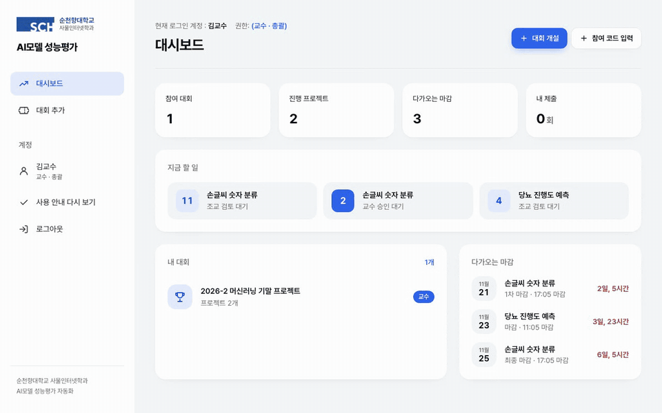 | **G02 참여 코드 가입 → 처음 로그인 사용 안내**<br>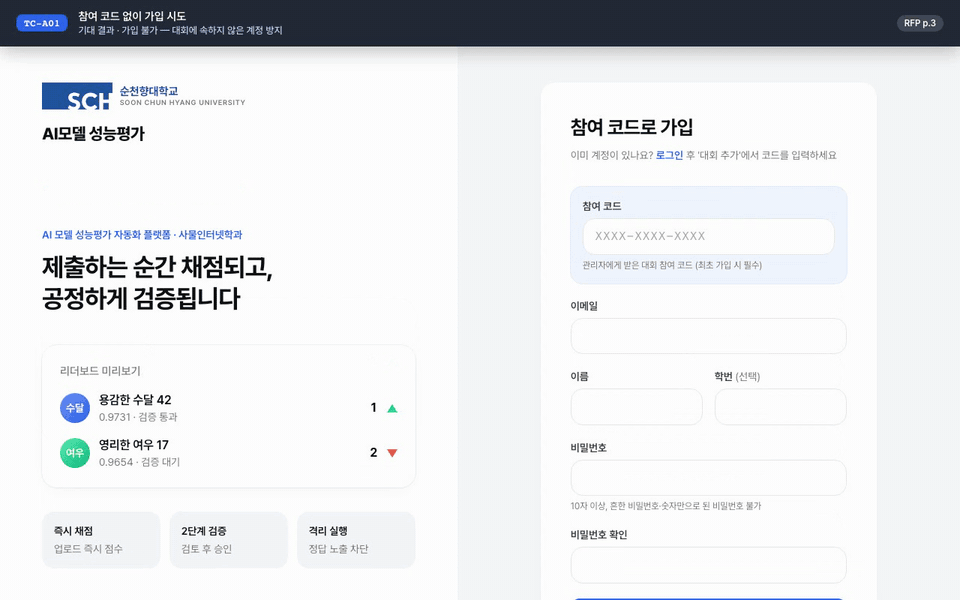 |
| **G03 제출 → 즉시 채점 → 순위** (1회 차감)<br> | **G04 형식 오류 행 단위 안내** (횟수 미차감)<br>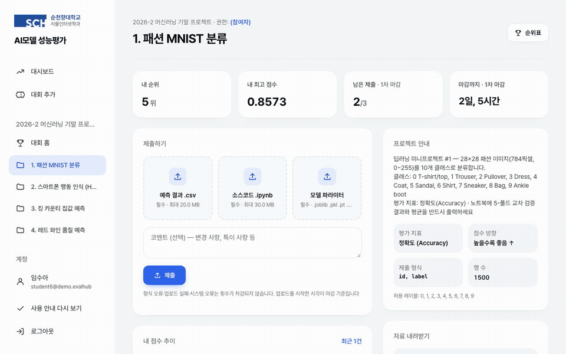 |
| **G05 마감 경계** (마감 전 시작·후 완료 = 채점 / 마감 후 = 접수만)<br>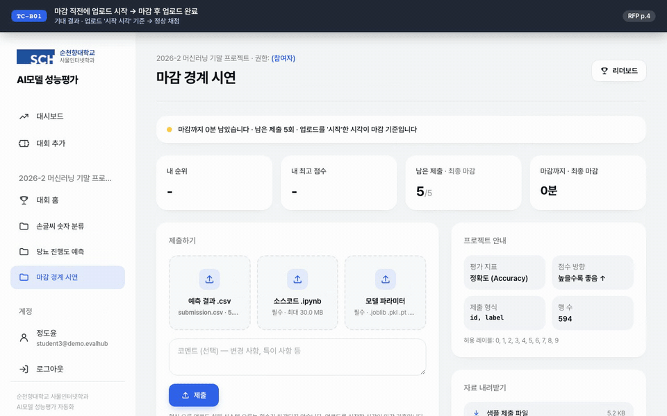 | **G08 같은 리더보드: 참여자 익명 vs 관리자 실명**<br>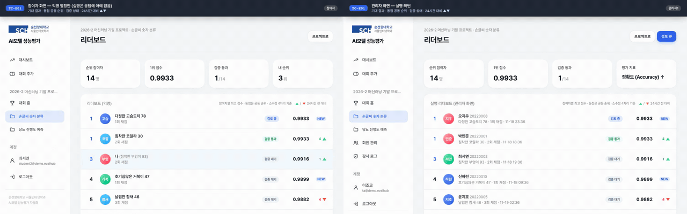 |
| **G09 관리자1 검토 · 무결성 리포트 · 판정 제안**<br>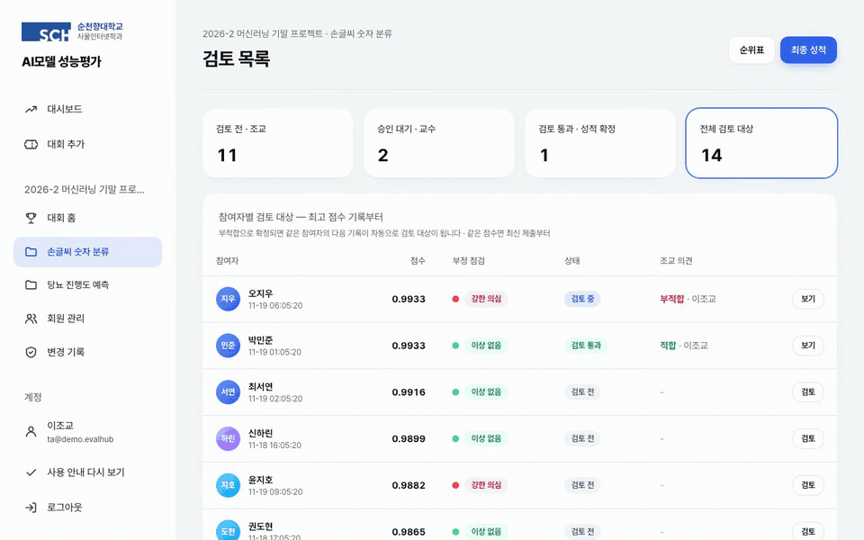 | **G10 관리자2 부적합 확정 → 다음 기록 · 일괄 승인**<br>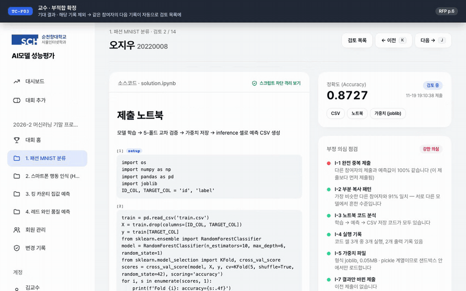 |
| **G11 부정 제출 적발 + 격리 재실행(I-6)**<br>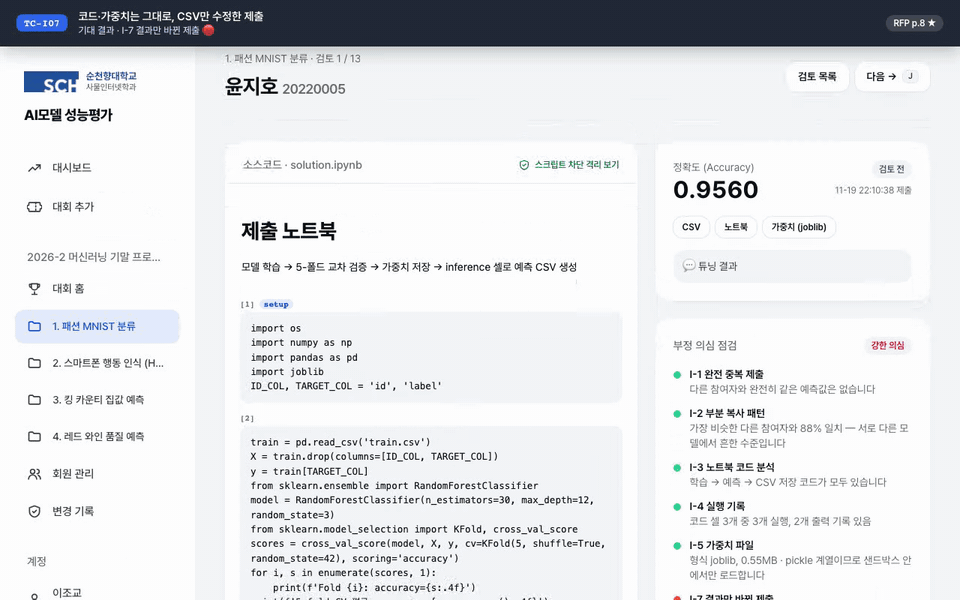 | **G12 샌드박스 공격 6종 실측 차단**<br>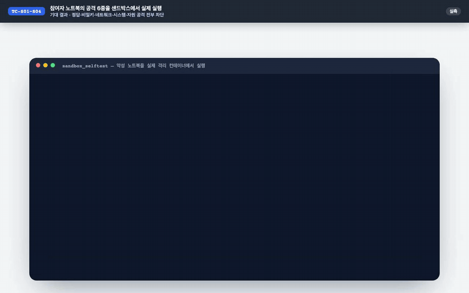 |
| **G13 노트북 XSS 무력화** (관리자 세션 보호)<br>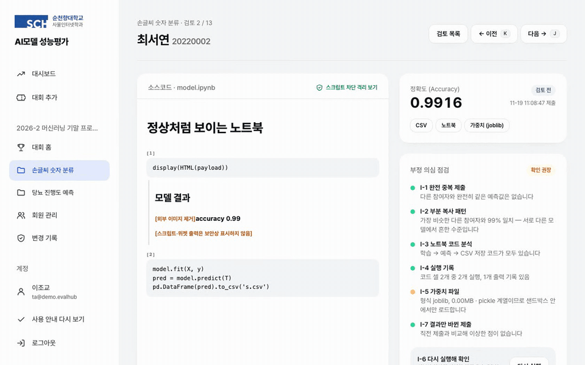 | **G15 권한 우회 차단** (설정·타인 제출물 → 404)<br>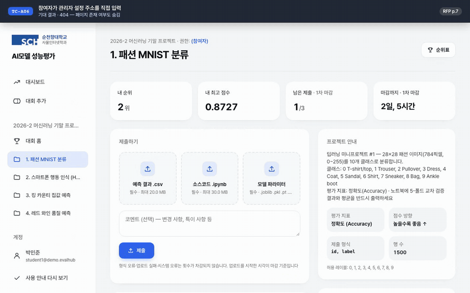 |
| **G16 감사 로그 위변조 감지**<br>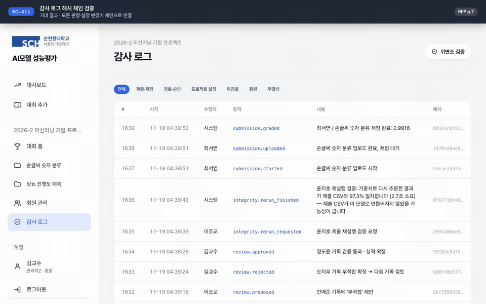 | **G17 전체 자동화 테스트 140개 통과**<br>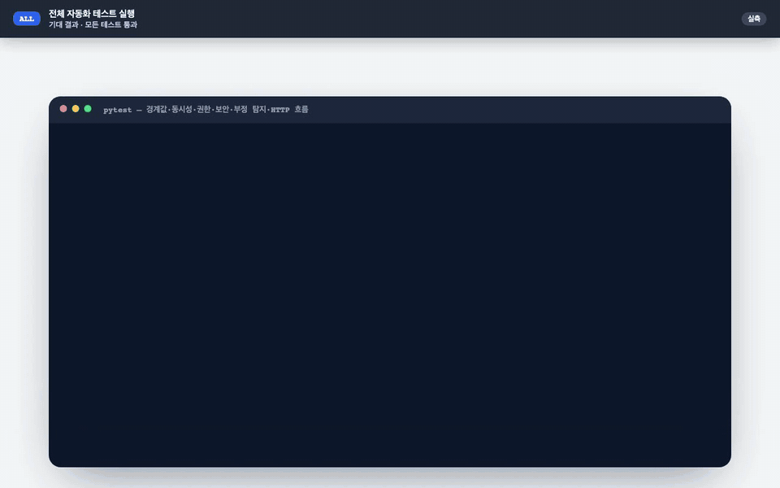 |
| **G18 부정 탐지 실험** (정직 20 · 부정 30)<br>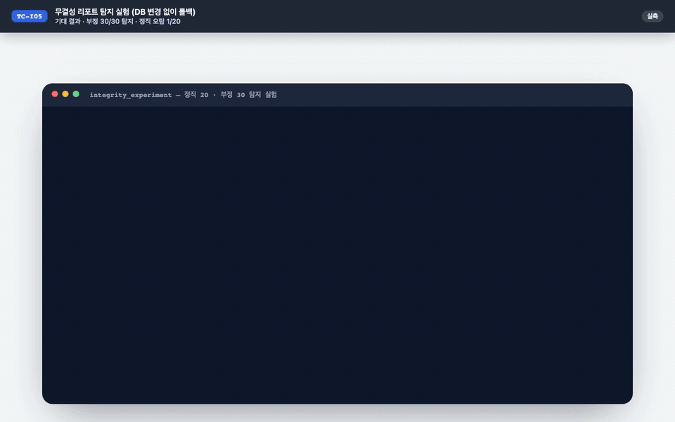 | |

---

## 역할별 기능 둘러보기

> 화면에서는 RFP 의 관리자1·관리자2 를 **조교·교수**로, 어려운 용어는 쉬운 말로 표시합니다 (예: 검토 큐 → 검토 목록, 감사 로그 → 변경 기록). 처음 로그인하면 **역할별 사용 안내 5단계**가 뜨고, 사이드바 '사용 안내 다시 보기'로 언제든 다시 볼 수 있습니다

### 참여자
- 프로젝트별 **남은 제출 횟수·마감까지 남은 시간·내 순위**를 첫 화면에 표시
- 학습 데이터 / **정답이 제거된 테스트 특성** / 샘플 제출 / 템플릿 노트북 다운로드
- 드래그 앤 드롭 제출 → **브라우저 사전 검사**(헤더·행 수·ID·레이블) → 파일 지문 계산 → 진행률 → 즉시 점수·순위
- 내 점수 추이 막대 차트, 제출 이력(상태·검증 배지)
- 익명 리더보드 (대회별 무작위 별칭, 내 행 강조, 24시간 대비 ▲▼)

### 관리자1 (조교)
- **검토 목록**: 참여자별 검토 대상을 최고 점수부터, 부정 의심 신호등과 함께
- **검토 화면**: 격리 노트북 뷰어 + 무결성 리포트 + 같은 참여자 제출 이력 + 판정 제안 (사유 템플릿, 단축키 `J`/`K`/`A`/`R`)
- 버튼 한 번으로 **I-6 격리 재실행** (가중치로 다시 추론해 제출 CSV와 비교)
- 회원 관리: 검색, 비활성화, 비밀번호 재설정 링크 발급 (이메일 없이 링크 전달)
- 실명 리더보드, 최종 성적 CSV 내보내기 (엑셀 수식 주입 방지)

### 관리자2 (교수)
- 대회 개설 → 참여자·운영 코드 자동 발급 (한 번만 표시, 해시 저장, 재발급)
- **프로젝트 설정 마법사**: 정답 포함 테스트셋 업로드 → **규격 자동 추론**(ID 열·정답 열·분류/회귀·허용 레이블·행 수) → 확정 시 **배포 파일 자동 생성**(정답 열 제거 테스트 특성·샘플 제출·템플릿 노트북)
- 마감일 여러 개·마감일별 횟수, 지표·점수 방향·동점 자릿수·업로드 유예 시간 설정
- 승인 큐: 관리자1 의견과 근거를 보고 **일괄 승인** / 부적합 확정 → 다음 기록 자동 상정
- 정답 교체 시 자동 전체 재채점, 감사 로그 **위변조 검증**

---

## 핵심 설계 결정

### 1. 정답을 보는 프로세스와 참여자 코드를 실행하는 프로세스의 분리

```
                 ┌────────────── web (Django) ──────────────┐
 브라우저 ──────▶│ 업로드 티켓 · 내용 검증 · UUID 저장 · 화면 │
                 └───────┬───────────────────────────┬──────┘
                         │ Redis 큐                   │
           ┌─────────────▼──────────┐   ┌─────────────▼──────────────┐
           │ worker (채점)           │   │ sandbox-worker (검증)        │
           │ 정답 O · 코드 실행 X     │   │ 정답 X · 컨테이너 지시만       │
           │ CSV는 '데이터'로만 파싱   │   └─────────────┬──────────────┘
           └────────────────────────┘                 │ docker run
                                          ┌───────────▼─────────────────────┐
                                          │ 샌드박스 컨테이너 (매번 새로 생성) │
                                          │ 네트워크 없음 · 읽기 전용 · 비루트  │
                                          │ 권한 전부 제거 · CPU/메모리/PID 제한 │
                                          │ 정답·비밀키 없음 → 훔칠 것이 없음    │
                                          └─────────────────────────────────┘
```

"코드가 정답을 못 읽게 막는" 대신 **정답이 아예 없는 곳에서 실행**합니다. 규칙 하나가 빠져도 뚫리지 않는 구조입니다.

### 2. 업로드 티켓 + 해시 선언 (마감 규칙)
업로드를 시작하는 순간 서버가 시각을 기록하고, 브라우저가 계산한 **파일 SHA-256을 먼저 등록**합니다. 업로드가 끝나면 지문을 대조합니다. → "마감 직전 티켓만 받아 두고 마감 후 더 좋은 파일로 바꿔치기"를 차단합니다 (RFP가 명시하지 않은 허점).

### 3. 좌석 예약 방식 횟수 처리
시작 시 슬롯을 `RESERVED` → 채점 성공 `USED`(차감) / 오류 `RELEASED`(반환). 예약은 사용자 행 잠금 안에서만 일어나 **남은 1회에서 동시에 10번 제출해도 1건만** 통과합니다 (`test_C04`).

---

## 부정 제출 탐지 — 무결성 리포트

| 코드 | 검사 | 잡아내는 것 | 방법 |
|---|---|---|---|
| I-1 | 완전 중복 | 다른 참여자 CSV 그대로 제출 | 예측값 지문 비교, 먼저 낸 쪽 표시 |
| I-2 | **부분 복사 패턴** | 남의 CSV를 일부 고쳐 제출 | 상대와 대부분 같은데, **갈리는 행에서 내 답이 다른 참여자 누구도 안 내는 부자연스러운 답**인가 — 정직한 모델은 갈리는 행에서도 '그럴듯한' 답을 낸다 (비교 참여자 10명 미만이면 🟡까지만) |
| I-3 | 노트북 코드 분석 | 예측값을 손으로 적은 CSV | AST 정적 분석 (실행 안 함): 학습·예측·저장 코드, 상수 30개+ 목록 |
| I-4 | 실행 기록 | 실행하지 않은 노트북 | 실행 횟수·순서·출력 |
| I-5 | 가중치 파일 | 빈/가짜 가중치 | 형식·크기 (pickle은 샌드박스에서만 로드) |
| I-6 | **추론 재실행** | CSV가 이 모델에서 나왔는가 | 격리 컨테이너에서 `inference` 셀만 재실행 → 제출 CSV와 일치율 |
| I-7 | 결과만 바뀐 제출 | 코드·가중치 그대로, CSV만 수정 | 직전 제출과 노트북·가중치 지문 비교 |
| I-8 | **교차 검증 출력** (수업 규칙) | 'k-폴드 결과와 평균 출력 필수' 위반, 부풀린 보고값 | 실행 출력에서 폴드 점수 k개·평균을 찾고, 보고한 평균과 **숨겨 둔 정답 기준 점수**를 비교 (프로젝트별로 켜고 끔) |

데모 데이터의 실제 결과 — 정직한 제출 31건(4개 프로젝트)은 전부 🟢, 부정 사례 4건은 각각 정확한 코드로 🔴, 수업 규칙 위반·실수 2건은 🟡:

| 참여자 | 행동 | 결과 |
|---|---|---|
| 오지우 | 박민준의 CSV 그대로 (패션 MNIST) | 🔴 I-1 완전 중복 · I-6 재실행 일치율 81.5% |
| 한예준 | 최서연의 CSV를 30문항 바꿔 제출 | 🔴 I-2 부분 복사 패턴 · 🟡 I-8 보고한 교차 검증 평균과 실제 점수 불일치 |
| 임수아 | 예측값을 코드에 직접 기입 | 🔴 I-3 노트북 코드 분석 · 🟡 I-8 교차 검증 출력 없음 |
| 윤지호 | 노트북·가중치 그대로 CSV만 수정 | 🔴 I-7 결과만 바뀐 제출 · I-6 일치율 89.7% · 🟡 I-8 |
| 신하린 | 교차 검증 결과를 출력하지 않은 노트북 (HAR) | 🟡 I-8 수업 규칙상 결과 처리 제외 대상 |
| 송유나 | 훈련 데이터로 '검증'한 RMSE 를 보고 (킹 카운티) | 🟡 I-8 보고 평균 60,643 vs 실제 126,547 |

> I-8 은 실제 수업 노트북(정원의 딥러닝·머신러닝 미니프로젝트 제출본 8개)으로 출력 형식을 검증해 만들었다 — numpy 배열 줄바꿈·`1.` 표기, `(10-fold)` 의 숫자, 오차 행렬·분류 리포트의 숫자를 폴드 점수로 오인하지 않는다

### 탐지 실험 (정직 20 · 부정 30)

`python manage.py integrity_experiment --rerun` — 서로 다른 모델 20종의 정직한 제출과 부정 제출 30건(완전 복사·변형 복사·직접 기입·CSV만 수정)을 만들어 측정. 상세: [docs/INTEGRITY_EXPERIMENT.md](docs/INTEGRITY_EXPERIMENT.md)

| | 결과 |
|---|---|
| 부정 제출 탐지율 (🔴) | **30/30 = 100%** |
| 정직한 제출 오탐 (🔴) | **1/20 = 5%** (같은 random_state 의 의사결정나무 두 개 — 사실상 같은 모델) |
| 정직한 제출 재실행 재현율 (I-6) | **20/20** |

> 첫 실험에서는 I-2 를 '오답 일치율'로 판정해 정직한 제출 11건을 🟡/🔴로 잘못 표시했다. 10클래스 문제에서는 서로 다른 모델도 같은 숫자를 헷갈리기 때문이다. 실험 데이터로 원인을 분석해 '갈리는 행의 부자연스러운 답' 지표로 바꿨고, 오탐이 55% → 5%로 줄었다.

> 시스템은 **자동으로 부적합 처리하지 않습니다.** 어디를 볼지 알려줄 뿐, 판단은 관리자1 → 관리자2가 합니다 (RFP 원칙).

---

## 보안 — 행정안전부 SW 개발보안 가이드 대응

상세: [docs/SECURITY.md](docs/SECURITY.md)

```text
$ python manage.py sandbox_selftest
  S01   정답 파일 읽기             BLOCKED ✓
  S02   비밀키·환경 변수 탈취       BLOCKED ✓
  S03   외부·내부 네트워크 접속     BLOCKED ✓
  S03b  시스템 파일 변조           BLOCKED ✓
  S04   프로세스 폭탄             BLOCKED ✓
  S04b  메모리 폭탄               BLOCKED ✓
6/6 공격 차단 · 6.6초
```

| 가이드 보안약점 | 대응 |
|---|---|
| SQL 삽입 · XSS · CSRF | ORM 전용, 템플릿 자동 이스케이프, 노트북 3중 정제, CSRF 토큰, CSP `script-src 'self'` (인라인 스크립트 0개) |
| 경로 조작 · 위험한 파일 업로드 | UUID 저장명 + 경로 검증, 매직 바이트·파싱 검증, 웹 루트 밖 저장 |
| 신뢰할 수 없는 데이터의 역직렬화 | **pickle 가중치는 웹·채점 서버에서 절대 로드하지 않음**, 샌드박스에서만 |
| 경쟁조건(TOCTOU) | 제출 횟수 좌석 예약 + `SELECT … FOR UPDATE` |
| 부적절한 인가 · 중요정보 노출 | 권한 정책 단일 모듈 + 권한 매트릭스 테스트, 권한 없음은 404, 실명은 서버에서 제외 |
| 반복 인증 시도 · 취약한 비밀번호 | 로그인 10회·참여 코드 10회 실패 시 15분 제한, Argon2, 10자 이상·흔한 비밀번호 차단 |
| 오류 메시지 정보노출 · 하드코드된 중요정보 | 추적 ID만 표시, 로그 비밀값 마스킹, `.env` 분리 |
| 취약한 라이브러리 | `pip-audit` 웹·샌드박스 라이브러리 취약점 0건, CI 에서 발견 시 빌드 실패 · 샌드박스 버전 고정 |

---

## 장애 대책

| 상황 | 대책 |
|---|---|
| 채점 중 예외 | 3회 자동 재시도 → 실패 시 `시스템 오류`, **횟수 미차감** |
| 워커 비정상 종료 | 제출은 DB에 `채점 대기`로 보존, 워커 재시작 시 `recover_stuck`이 자동 재등록 |
| 마감 직전 폭주 | 웹은 업로드만 받고 채점은 큐로 → 응답 유지. 마감 판정은 시작 시각 기준이라 지연돼도 불이익 없음 |
| 정답 파일 오류 | 정답 교체 → 자동 전체 재채점 (감사 로그 기록) |
| 업로드만 시작하고 중단 | 유예 시간이 지나면 티켓 만료, 슬롯 자동 반환 |
| 무한 루프·메모리 폭탄 노트북 | 샌드박스 시간·메모리·PID 제한으로 강제 종료 |

---

## 서버 배포

VM 1대 + Docker + Caddy(HTTPS 자동) 구성, 약 30분 — 단계별 명령·`.env` 필수 변경값·백업/복구·배포 후 점검표: [docs/DEPLOY.md](docs/DEPLOY.md)

- web 은 `127.0.0.1` 에만 열고 외부는 HTTPS 프록시로만 접속
- 프록시 뒤에서도 실패 횟수 제한이 **접속자별로** 동작 (`TRUSTED_PROXY_COUNT` — 설정하지 않으면 위조 가능한 헤더는 무시)
- `manage.py check --deploy` 경고 0건 (의도된 3건은 사유를 코드에 기록)

---

## 성능 · 자원 사용량

상세: [docs/PERFORMANCE.md](docs/PERFORMANCE.md)

| 마감 직전 **50명 동시 제출** | 결과 |
|---|---|
| 성공률 | **50/50** (실패 0) |
| 업로드 시작 → 채점 완료 | 중앙값 **2.85초** · p95 4.44초 |
| 업로드 티켓 발급 (웹 응답) | 중앙값 0.10초 — 채점 부하와 무관 |
| 전체 스택 메모리 | 유휴 약 600MiB · 부하 중 약 840MiB → 소형 VM 1대로 학과 단위 운영 가능 |

---

## 파일 구조

```
├── docker-compose.yml          # web · worker · sandbox-worker · db · redis
├── .env.example                # 환경 변수 예시 (실제 .env 는 커밋 금지)
├── sandbox/                    # 참여자 노트북 격리 실행 이미지 (Dockerfile, run.py)
├── docs/                       # 기획·보안·성능·탐지 실험·요구사항 추적·배포·사용성 테스트·발표 가이드
│   ├── adr/                    # 설계 결정 기록 5건
│   ├── usability/              # 사용성 테스트 기록 양식 (SUS·과제·업무 시간)
│   └── assets/gifs/            # 테스트 케이스 시연 GIF 15개
├── presentation/               # 발표 자료 (.pptx 발표자 노트 포함 · PowerPoint 없는 PC 용 PDF 백업)
├── scripts/
│   ├── record_gifs/            # Playwright 시나리오 → GIF 자동 녹화 (record.py, overlay.js)
│   ├── build_presentation.py   # 발표 자료 생성 · pptx_preview.py 슬라이드 미리보기
│   ├── presentation_notes.py   # 발표 대본(15분) → 발표자 노트 + docs/PRESENTATION_SCRIPT.md
│   ├── loadtest.py             # 50명 동시 제출 부하 테스트
│   └── usability_report.py     # SUS·과제·업무 시간 기록 → README 표
└── web/                        # Django 프로젝트
    ├── config/                 # 설정 (환경 변수 기반, 안전한 기본값)
    ├── apps/
    │   ├── core/               # 권한 정책, 보안 미들웨어, 안전한 저장소, 작업 큐, 데모 생성기
    │   ├── accounts/           # 코드 가입·대회 추가·비밀번호 재설정
    │   ├── competitions/       # 대회·프로젝트·마감일·규격 추론·배포 파일·회원·감사 로그 화면
    │   ├── submissions/        # 업로드 티켓·해시 선언·파일 내용 검증·횟수 슬롯
    │   ├── grading/            # 지표 레지스트리·CSV 검증·채점 워커·재채점·장애 복구
    │   ├── leaderboard/        # 최고 점수·공동 순위·익명화·순위 변화
    │   ├── review/             # 검토 상태 머신·일괄 승인·안전한 노트북 렌더러
    │   ├── integrity/          # 무결성 검사 I-1~I-8·샌드박스 재실행·자가 진단
    │   └── audit/              # 해시 체인 감사 로그
    ├── templates/  static/  assets/app.css (디자인 토큰)
    └── Dockerfile · entrypoint.sh
```

---

## 테스트

```bash
cd web && ../.venv/bin/pytest            # 140개 — 경계값·동시성·권한 매트릭스·보안·부정 탐지·HTTP 흐름·접근성·쿼리 수·사용 안내
../.venv/bin/python manage.py sandbox_selftest   # 샌드박스 공격 6종 실측 (compose: sandbox-worker 컨테이너에서)
../.venv/bin/python manage.py integrity_experiment --rerun   # 부정 탐지 실험 (정직 20 · 부정 30)
```

| 분류 | 예시 |
|---|---|
| 마감 경계 | 마감 10초 전 시작·마감 후 완료 → 채점 / 마감 후 시작 → 접수만 / 티켓 후 파일 바꿔치기 → 거부 |
| 횟수 | 성공 차감 · 형식 오류 미차감 · 시스템 오류 3회 재시도 후 미차감 · 부적합 차감 유지 · **동시 10건 중 1건만** |
| 리더보드 | 공동 순위 1·1·3 · 낮을수록 좋은 지표 · 참여자 응답에 실명 없음 |
| 검증 흐름 | 동점이면 최신부터 · 제안만으로 순위 유지 · 부적합 → 다음 기록 · 관리자1의 승인 시도 차단 |
| 보안 | 노트북 XSS 제거 · `.exe` 위장 CSV · 경로 조작 파일명 · CSV 수식 주입 · 감사 로그 변조 감지 |

---

## 사용성 검증

실제 사용자(학과 동기)가 과제 4개를 수행하고 SUS 설문(표준 사용성 점수)에 답하는 방식 — 진행 가이드: [docs/USABILITY_TEST.md](docs/USABILITY_TEST.md)

```bash
docker compose exec web python manage.py usability_kit --out /data/usability_kit   # 테스터용 참여 코드 + 제출 파일(정상·오류)
python scripts/usability_report.py sus.csv tasks.csv time.csv   # 결과 → 이 절에 붙일 표
```

> 결과는 테스트 진행 후 이 자리에 추가

**접근성 (WCAG 2.1 AA)** — 글자 대비·입력 라벨·키보드 포커스·본문 바로가기·휴대폰 화면(375px)을 점검해 13건을 수정하고, 라벨 누락·id 중복은 자동화 테스트로 막았다 → [docs/ACCESSIBILITY.md](docs/ACCESSIBILITY.md)

---

## 기술 스택

Django 5.2 · PostgreSQL 17 · Redis 7 + RQ · HTMX · Tailwind CSS 4 · Pretendard · pandas · scikit-learn · nbformat/nbclient · nh3 · Docker SDK

## 한계와 향후 계획

- PyTorch·TensorFlow 모델 재실행은 샌드박스 이미지에 패키지를 추가해 빌드해야 함 (`sandbox/Dockerfile`의 `EXTRA_PACKAGES`)
- GPU가 필요한 노트북 재실행은 범위 밖 (CPU 시간 제한 내 추론만)
- 이메일 알림·토론 게시판은 미구현 (단톡방 운영을 대체하지 않음)
- 운영 배포 시 샌드박스는 gVisor 등 추가 격리 런타임 사용 권장

---

<div align="center"><sub>순천향대학교 사물인터넷학과 · AI모델 성능평가 자동화 경진대회 2026</sub></div>
